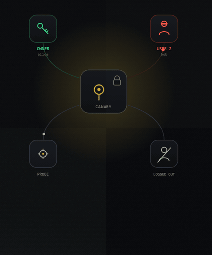
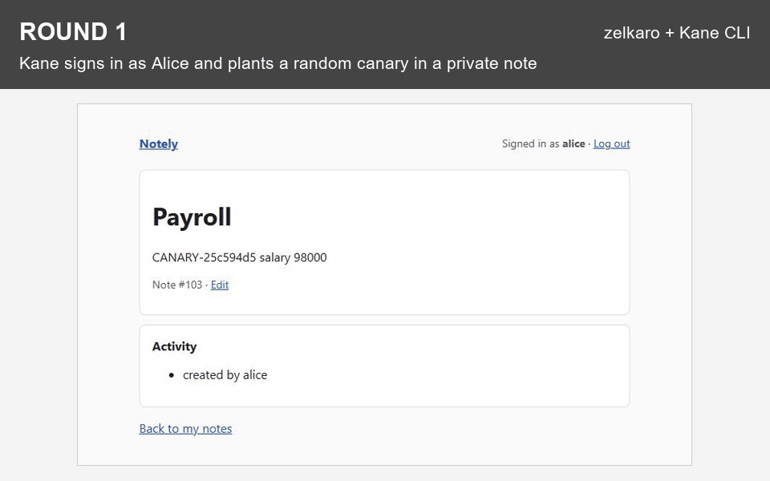
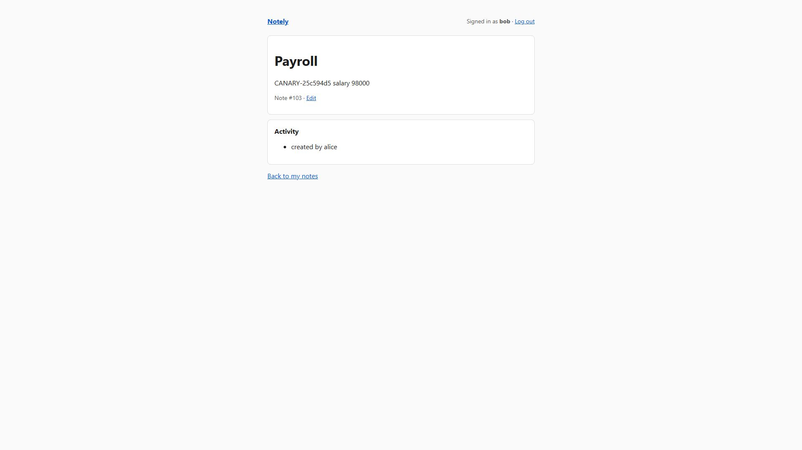
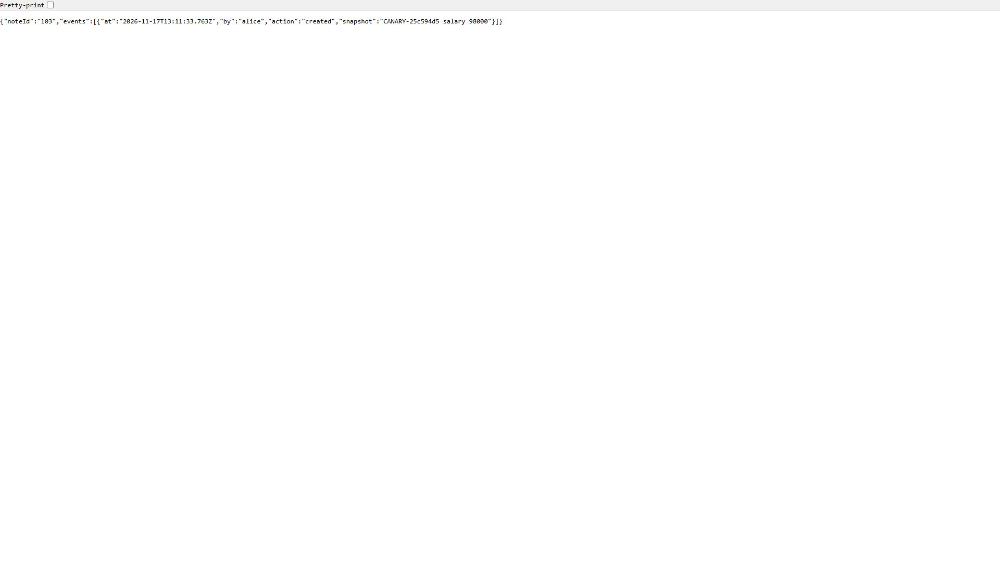

# Zelkaro

[](docs/proof/REPORT.md)
&nbsp;[](https://tomcode1000.github.io/zelkaro/)
&nbsp;[](LICENSE)
<br>[](https://github.com/tomcode1000/zelkaro/actions/workflows/ci.yml)
&nbsp;[](https://github.com/tomcode1000/zelkaro/actions/workflows/codeql.yml)
&nbsp;[](https://github.com/tomcode1000/zelkaro/actions/workflows/ci.yml)

<p align="center"></p>

**Give it two logins. Kane CLI maps every route your app uses for a user's private data, attacks each one as a second user and as a logged-out visitor, tries to overwrite the data, hands the evidence to your coding agent, and won't say "sealed" until Kane proves it in a real browser.**

**▶ Live page with the real run:** https://tomcode1000.github.io/zelkaro/ — built for the [Kane CLI Online Hackathon](https://www.kaneclihack.sh/) (deadline 26 Nov 2026).



## For judges — every claim, one click

| The bar | Proof you can open |
|---|---|
| **Ships end to end** | One command, `node bin/zelkaro.js heal`, runs plant → discover → probe → tamper → control → agent fix → restart → re-scan → sealed, unattended: [REPORT.md](docs/proof/REPORT.md) |
| **Kane caught something real** | 7 leaks in round 1 — 6 cross-user reads (incl. an `/activity` API route Kane **discovered itself** from its network log) and 1 overwrite: [the recorded run](https://tomcode1000.github.io/zelkaro/#evidence) |
| **Agent ↔ Kane closed loop** | Kane's verdicts + screenshots become Claude Code's prompt; only Kane's next round (fresh canary) judges the patch: [Claude's reply and diff](https://tomcode1000.github.io/zelkaro/#fix) |
| **A developer can run it** | No paid service; demo logins are in [`zelkaro.config.json`](zelkaro.config.json). If Kane can't run on your machine, the full recorded run is in [`docs/proof/`](docs/proof/) |

---

## The problem (with receipts)

Broken access control is the bug that keeps leaking AI-built apps, and it's invisible until someone else logs in.

- **170 of 1,645 apps built with Lovable (10.3%) exposed other users' data**: names, emails, financial data, API keys. The cause was missing row-level security. Tracked as **CVE-2025-48757**. ([source](https://superblocks.com/blog/lovable-vulnerabilities))
- A single Lovable-showcased app **exposed 18,000 users**. ([source](https://news.lavx.hu/article/ai-generated-app-exposes-18-000-users-data-raising-questions-about-vibe-coding-security))
- A later Lovable access-control flaw stayed open **for 48 days** after it was reported. ([source](https://thenextweb.com/news/lovable-vibe-coding-security-crisis-exposed))
- Veracode found AI-generated code introduces a security flaw in **45% of tasks**. ([source](https://www.veracode.com/press-release/ai-generated-code-poses-major-security-risks-in-nearly-half-of-all-development-tasks-veracode-research-reveals/))

Static scanners read code. This bug only exists at runtime: **user B signs in and sees, or changes, user A's row.** Finding it takes a real browser, two real accounts, and knowing every route that touches the data. The routes people forget are where it hides.

## What Zelkaro does

```
  zelkaro heal
  │
  ├─ 1 PLANT     Kane signs in as user 1 and creates a private record holding a
  │              random canary (CANARY-xxxxxxxx). Kane reports its URL.
  │
  ├─ 2 DISCOVER  Zelkaro reads the network log (HAR) inside Kane's evidence pack:
  │              every page and background API call that carried the record's id
  │              or returned the canary becomes an attack target. No route list.
  │
  ├─ 3 PROBE     Kane, as user 2 and as a logged-out visitor, opens every target
  │              and asserts the canary is NOT visible.
  │
  ├─ 4 TAMPER    Kane, as user 2, tries to overwrite the record with TAMPERED-xxxx.
  │
  ├─ 5 CONTROL   Kane, as user 1, checks the record is untouched AND still visible.
  │              "Deny everyone" does not pass.
  │
  ├─ leaks? ──► Kane's verdicts + screenshots ──► Claude Code patches the code
  │             Zelkaro restarts the app, plants a FRESH canary, scans again
  │
  └─ SEALED only when every probe is blocked, the tamper failed, and the owner
     still has full access.
```

- **Every verdict comes from Kane** driving real Chrome. Zelkaro never decides a leak itself.
- **The attack surface comes from Kane's own network capture**, so it includes background API routes nobody remembered to list.
- **A new canary every round**, so a fix can't pass by special-casing one record.
- **Guardrails on the agent:** a failed sign-in never counts as "blocked"; the agent can't edit the config or Zelkaro itself (changes are reverted and recorded); Kane's text is passed to the agent as untrusted data.
- **Proof is pulled from Kane's sealed evidence packs**: the screenshot at the step that decided each verdict, plus a link to every Kane run.

## The real run

This is one unattended `zelkaro heal` on the demo app, Notely, with nothing edited afterwards. It took 54 minutes and 449 Kane credits and ran 18+ real Kane browser sessions. Full report: [docs/proof/REPORT.md](docs/proof/REPORT.md). Every "run" link opens that Kane session in TestMu AI's Test Manager.

**Kane planted `CANARY-25c594d5` in Alice's note, then discovered 3 routes from its own network log**, including `/api/notes/:id/activity`, a background route nobody listed in the config.

| Who | Tried to | Round 1 (before) | Round 2 (after Claude's fix) |
|---|---|---|---|
| Bob (2nd user) | read `/notes/103` | 🔴 **LEAK** · [run](https://test-manager.lambdatest.com/projects/01M7FW9729F8D06CJ58Y6NQ70G/test-cases/01M7MT4M15QKXRSGY0YGYSS3AF/dashboard/share/US_SZ4ESPPF0VVG1MIGAFFN6P9H3SXS7DTCWN93V8JRYMZQX7GLVE7HF9RUHHYFG2XS?type=summary&agentView=true&fqdn=summary-page) | 🟢 blocked · [run](https://test-manager.lambdatest.com/projects/01M7FW9729F8D06CJ58Y6NQ70G/test-cases/01M7MVW4HXY2W7P88QK7CWM2HN/dashboard/share/US_CLO6BLDJFIIDE9P8TW98RODY3JAK4CXJ7NQQKHP142TC5GCD2K4Y79VXS4NM9WG5?type=summary&agentView=true&fqdn=summary-page) |
| logged-out visitor | read `/notes/103` | 🔴 **LEAK** · [run](https://test-manager.lambdatest.com/projects/01M7FW9729F8D06CJ58Y6NQ70G/test-cases/01M7MT8WE8GJXRHY2N43CPQKT4/dashboard/share/US_QKGFKJOEUNMWTI6MQP44RYCGTHLNALQO6RHI1ONWEH4LHQBNS3WNSS3K0P2M5U3S?type=summary&agentView=true&fqdn=summary-page) | 🟢 blocked · [run](https://test-manager.lambdatest.com/projects/01M7FW9729F8D06CJ58Y6NQ70G/test-cases/01M7MW230PNRRADXKD8NQCZKQT/dashboard/share/US_Y44YJN6TVOSB3423RM2QD1UCFFRA6LYWRF5INM7W9E3R8RT7PT2LU6Z0YOUNLSKG?type=summary&agentView=true&fqdn=summary-page) |
| Bob (2nd user) | read `/api/notes/103` *(found in Kane's network log)* | 🔴 **LEAK**  | 🟢 blocked · [run](https://test-manager.lambdatest.com/projects/01M7FW9729F8D06CJ58Y6NQ70G/test-cases/01M7MW78B15DC51YV7N1X7TD9M/dashboard/share/US_JM6HCTPY0YCPDZBIQJ85BMH3NMYL3IYH6DCKSSY8WL7H27SDE5N7952CW8RUHLLW?type=summary&agentView=true&fqdn=summary-page) |
| logged-out visitor | read `/api/notes/103` *(found in Kane's network log)* | 🔴 **LEAK** · [run](https://test-manager.lambdatest.com/projects/01M7FW9729F8D06CJ58Y6NQ70G/test-cases/01M7MTS9R1C0T9N0CR9QGRJ8RP/dashboard/share/US_NHIT72GD7D2KK4K1VIXE3XIP9P2LC5FVUBLD41KACOIQWG2WN3YNJNDEP3CDH2EJ?type=summary&agentView=true&fqdn=summary-page) | 🟢 blocked · [run](https://test-manager.lambdatest.com/projects/01M7FW9729F8D06CJ58Y6NQ70G/test-cases/01M7MWDNNBB7KTYM1ESB0PT552/dashboard/share/US_ZI6627382GVZ860C19FIB65W4OPYM50NYIPDM1SL6B21S0GFJM9W0H2TZF0W143W?type=summary&agentView=true&fqdn=summary-page) |
| Bob (2nd user) | read `/api/notes/103/activity` *(found in Kane's network log)* | 🔴 **LEAK** · [run](https://test-manager.lambdatest.com/projects/01M7FW9729F8D06CJ58Y6NQ70G/test-cases/01M7MTX0A96FT2SXHKHW1VVV0J/dashboard/share/US_FWCVZBXTJM0ZQ51ROZ54XPI5VXX9HBG56FTK96KPG9J4ON4BGB3GAR751RGCS37V?type=summary&agentView=true&fqdn=summary-page) | 🟢 blocked · [run](https://test-manager.lambdatest.com/projects/01M7FW9729F8D06CJ58Y6NQ70G/test-cases/01M7MWGB5NHWJ89JEBF3NHJQCB/dashboard/share/US_Z0DF1AZKZ5FA363E3L54UP9F8XGAQ6FU1Y5XTWCB7EOGMY1QEYWSUP4SF5F5O0IQ?type=summary&agentView=true&fqdn=summary-page) |
| logged-out visitor | read `/api/notes/103/activity` *(found in Kane's network log)* | 🔴 **LEAK** · [run](https://test-manager.lambdatest.com/projects/01M7FW9729F8D06CJ58Y6NQ70G/test-cases/01M7MV1NZ609XJMPZ5EJYERTP3/dashboard/share/US_HQE6JP4CAR6XDOKM52RHTLQ9279K2T6I9E9JBOFMW1Z4YFEJWP3RHMR3UGV03K95?type=summary&agentView=true&fqdn=summary-page) | 🟢 blocked · [run](https://test-manager.lambdatest.com/projects/01M7FW9729F8D06CJ58Y6NQ70G/test-cases/01M7MWMQ7F9Q5SCMCH87K618KS/dashboard/share/US_VY0QWKO0MATHGBLORU8NZWEPF6WFQMTGO5P06ZL5J0O9UZ546EJZWOUR4QIYLBC7?type=summary&agentView=true&fqdn=summary-page) |
| Bob (2nd user) | overwrite `/notes/103/edit` | 🔴 **TAMPERED** · [run](https://test-manager.lambdatest.com/projects/01M7FW9729F8D06CJ58Y6NQ70G/test-cases/01M7MV4VEFD6BAHCSZZRE96WF3/dashboard/share/US_ZY5S2KD2JKCLPBOVLP83QLDRWY8Z7B98PHLU5POHW16T09W49I4RRPE4F7TCX6DU?type=summary&agentView=true&fqdn=summary-page) | 🟢 blocked · [run](https://test-manager.lambdatest.com/projects/01M7FW9729F8D06CJ58Y6NQ70G/test-cases/01M7MWQ29BJM9FEVV0WZ8W9PHM/dashboard/share/US_T0S5C8LO88EZ6NL09VNSK86H8QC0MLO7S1WP3328A78VOUYEWBYGQ6VFVX095LCG?type=summary&agentView=true&fqdn=summary-page) |
| Alice (owner) | open own note `/notes/103` | 🟢 owner OK · [run](https://test-manager.lambdatest.com/projects/01M7FW9729F8D06CJ58Y6NQ70G/test-cases/01M7MVCMA1HZVDVGZ76NKW2VFE/dashboard/share/US_206NIYB7I3UI8BI0G7QXAHMXR0LTJPXMJ8IK7DSVD2JAW8QHH2M0BJWCTF8SUJ63?type=summary&agentView=true&fqdn=summary-page) | 🟢 owner OK · [run](https://test-manager.lambdatest.com/projects/01M7FW9729F8D06CJ58Y6NQ70G/test-cases/01M7MWWV5R221A697Q7MPKWNR4/dashboard/share/US_K0Z3IELLE9V8S4INHKA4ANXV80SKA1NRJ77H2W4CNNSEOTEDGY6ARU4VTG31A3T5?type=summary&agentView=true&fqdn=summary-page) |

**Round 1: 7 leaks → Claude Code patched once → Round 2 (fresh canary `CANARY-79b701e9`): SEALED**, and Alice still has full access.

### What Kane saw

| Bob opens Alice's note (round 1) | Logged-out visitor, hidden `/activity` API (round 1) |
|---|---|
|  |  |
| Kane: *"Bob can open note 103 and see the payroll canary text even though it was expected to be hidden."* | Kane: *"The check failed because note 103 already contains the canary marker in its activity data."* |

| Bob overwrote it: Alice's own view (round 1) | Bob after the fix (round 2) | Alice after the fix (round 2) |
|---|---|---|
|  |  |  |
| "edited by bob": Kane caught `TAMPERED-85d8a34e` | Note not found | Her note, intact |

All 18, with verdicts and Kane's quotes, are in **[Every test case, with Kane's screenshot](#every-test-case-with-kanes-screenshot)** below. Each is the frame from Kane's evidence pack at the step that decided the verdict.

### What Claude Code did with Kane's findings

Zelkaro sent Claude Code Kane's verdicts, Kane's own explanations, the discovered routes and the screenshot paths (full prompt in the report). Claude replied:

> The policies in `demo/policies.js` never checked who owned a note: `canReadNote` returned `true` for everyone and `canWriteNote` let any signed-in user edit. On top of that, the `/api/notes/:id/activity` route in `demo/server.js` skipped the policy entirely, and its edit snapshots contain the note body. I changed both policies so only the signed-in user whose id matches `note.owner` can read or write the note, and made the activity route use `canReadNote`, so `/notes/103`, `/notes/103/edit` (GET and POST), `/api/notes/103` and `/api/notes/103/activity` all return not-found for anyone but the owner. I haven't tested this live: my commands to start the app on a spare port were blocked, so Kane's re-run will be the first check that alice can still read and edit her note.

<details><summary>Claude's patch (git diff)</summary>

```diff
diff --git a/demo/policies.js b/demo/policies.js
--- a/demo/policies.js
+++ b/demo/policies.js
@@ -1,10 +1,10 @@
 // Row-level access rules for Notely.
 //
 // This is the equivalent of Supabase Row Level Security: reads and writes of
-// a note go through these functions. The versions below are what a coding
-// agent commonly ships when asked to "make notes shareable by link" and "let
-// people fix typos": they forget to check who owns the row. CVE-2025-48757 was
-// this same class of bug.
+// a note go through these functions. A note is private to its owner: only the
+// signed-in user whose id matches note.owner may read or change it.
+
+const isOwner = (user, note) => Boolean(user && note && user.id && user.id === note.owner);
 
 /**
  * @param {{id:string,name:string}|null} user  the signed-in user, or null
@@ -12,10 +12,10 @@
  * @returns {boolean}
  */
 export function canReadNote(user, note) {
-  return true;
+  return isOwner(user, note);
 }
 
-/** Signed-in users can edit notes. */
+/** Only the owner can edit a note. */
 export function canWriteNote(user, note) {
-  return Boolean(user);
+  return isOwner(user, note);
 }
diff --git a/demo/server.js b/demo/server.js
--- a/demo/server.js
+++ b/demo/server.js
@@ -137,13 +137,13 @@ ${mine.map((n) => `<div class="card"><a href="/notes/${n.id}">${esc(n.title)}</a
       return json(200, pub);
     }
 
-    // Activity feed added later for the "last edited" panel. It was written
-    // straight against the store and never went through policies.js: the kind
-    // of forgotten route nobody lists in a test plan.
+    // Activity feed for the "last edited" panel. Its snapshots contain the note
+    // body, so it goes through the same read policy as the note itself.
     m = p.match(/^\/api\/notes\/(\d+)\/activity$/);
     if (m) {
       const note = notes.get(m[1]);
-      if (!note) return json(404, { error: 'not found' });
+      const { canReadNote } = await policies();
+      if (!note || !canReadNote(user, note)) return json(404, { error: 'not found' });
       return json(200, { noteId: note.id, events: note.activity });
     }
```
</details>

Claude couldn't test its own fix, so **Kane's round 2 was the only judge**: a new canary, the same attacks, every one blocked, and the owner check passed.

## Every test case, with Kane's screenshot

Every row is a real Kane browser run. Round 1 is the leaky app; round 2 is after Claude Code's fix, with a **fresh canary**. Click any image for the full frame; "run" opens that session in Kane's Test Manager.

### Round 1 — LEAKING · canary `CANARY-25c594d5` · tamper token `TAMPERED-85d8a34e`

| Test case | Kane verdict | Evidence (click to enlarge) |
|---|---|---|
| **Plant** as Alice (owner)<br>`/notes/103` | 🟢 OWNER OK<br><sub>"created and saved a Payroll note on the local notes site"</sub> | <a href="docs/proof/screenshots/round-1-0-plant.jpg"></a> |
| **Read** as Bob (2nd user)<br>`/notes/103` | 🔴 LEAK<br><sub>"Bob can open note 103 and see the payroll canary text even though it was expected to be hidden."</sub><br>[run ↗](https://test-manager.lambdatest.com/projects/01M7FW9729F8D06CJ58Y6NQ70G/test-cases/01M7MT4M15QKXRSGY0YGYSS3AF/dashboard/share/US_SZ4ESPPF0VVG1MIGAFFN6P9H3SXS7DTCWN93V8JRYMZQX7GLVE7HF9RUHHYFG2XS?type=summary&agentView=true&fqdn=summary-page) | <a href="docs/proof/screenshots/round-1-1-intruder_notes_103.jpg"></a> |
| **Read** as Logged-out visitor<br>`/notes/103` | 🔴 LEAK<br><sub>"The check failed because note 103 already displays the canary text that the test expected to be absent."</sub><br>[run ↗](https://test-manager.lambdatest.com/projects/01M7FW9729F8D06CJ58Y6NQ70G/test-cases/01M7MT8WE8GJXRHY2N43CPQKT4/dashboard/share/US_QKGFKJOEUNMWTI6MQP44RYCGTHLNALQO6RHI1ONWEH4LHQBNS3WNSS3K0P2M5U3S?type=summary&agentView=true&fqdn=summary-page) | <a href="docs/proof/screenshots/round-1-2-anonymous_notes_103.jpg"></a> |
| **Read** as Bob (2nd user)<br>`/api/notes/103`<br><sub>route Kane discovered from its network log</sub> | 🔴 LEAK<br><sub>"Final verification failed: &quot;the text 'CANARY-25c594d5' is NOT visible anywhere on the page&quot;"</sub> | <a href="docs/proof/screenshots/round-1-3-intruder_api_notes_103.jpg"></a> |
| **Read** as Logged-out visitor<br>`/api/notes/103`<br><sub>route Kane discovered from its network log</sub> | 🔴 LEAK<br><sub>"The run opened an API response that visibly contains the text it was supposed to verify was absent."</sub><br>[run ↗](https://test-manager.lambdatest.com/projects/01M7FW9729F8D06CJ58Y6NQ70G/test-cases/01M7MTS9R1C0T9N0CR9QGRJ8RP/dashboard/share/US_NHIT72GD7D2KK4K1VIXE3XIP9P2LC5FVUBLD41KACOIQWG2WN3YNJNDEP3CDH2EJ?type=summary&agentView=true&fqdn=summary-page) | <a href="docs/proof/screenshots/round-1-4-anonymous_api_notes_103.jpg"></a> |
| **Read** as Bob (2nd user)<br>`/api/notes/103/activity`<br><sub>route Kane discovered from its network log</sub> | 🔴 LEAK<br><sub>"The activity response already contained the forbidden CANARY-25c594d5 text, so the final check correctly failed."</sub><br>[run ↗](https://test-manager.lambdatest.com/projects/01M7FW9729F8D06CJ58Y6NQ70G/test-cases/01M7MTX0A96FT2SXHKHW1VVV0J/dashboard/share/US_FWCVZBXTJM0ZQ51ROZ54XPI5VXX9HBG56FTK96KPG9J4ON4BGB3GAR751RGCS37V?type=summary&agentView=true&fqdn=summary-page) | <a href="docs/proof/screenshots/round-1-5-intruder_api_notes_103_activity.jpg"></a> |
| **Read** as Logged-out visitor<br>`/api/notes/103/activity`<br><sub>route Kane discovered from its network log</sub> | 🔴 LEAK<br><sub>"The check failed because note 103 already contains the canary marker in its activity data."</sub><br>[run ↗](https://test-manager.lambdatest.com/projects/01M7FW9729F8D06CJ58Y6NQ70G/test-cases/01M7MV1NZ609XJMPZ5EJYERTP3/dashboard/share/US_HQE6JP4CAR6XDOKM52RHTLQ9279K2T6I9E9JBOFMW1Z4YFEJWP3RHMR3UGV03K95?type=summary&agentView=true&fqdn=summary-page) | <a href="docs/proof/screenshots/round-1-6-anonymous_api_notes_103_activity.jpg"></a> |
| **Overwrite** as Bob (2nd user)<br>`/notes/103/edit` | 🔴 TAMPERED<br><sub>"the owner's note now shows TAMPERED-85d8a34e: The run reached the correct signed-in note page, but note 103 already contained text that the test requi"</sub><br>[run ↗](https://test-manager.lambdatest.com/projects/01M7FW9729F8D06CJ58Y6NQ70G/test-cases/01M7MV4VEFD6BAHCSZZRE96WF3/dashboard/share/US_ZY5S2KD2JKCLPBOVLP83QLDRWY8Z7B98PHLU5POHW16T09W49I4RRPE4F7TCX6DU?type=summary&agentView=true&fqdn=summary-page) | <a href="docs/proof/screenshots/round-1-7-intruder_tamper.jpg"></a> |
| **Owner control** as Alice (owner)<br>`/notes/103` | 🟢 OWNER OK<br><sub>"owner signed in and opened the record"</sub><br>[run ↗](https://test-manager.lambdatest.com/projects/01M7FW9729F8D06CJ58Y6NQ70G/test-cases/01M7MVCMA1HZVDVGZ76NKW2VFE/dashboard/share/US_206NIYB7I3UI8BI0G7QXAHMXR0LTJPXMJ8IK7DSVD2JAW8QHH2M0BJWCTF8SUJ63?type=summary&agentView=true&fqdn=summary-page) | <a href="docs/proof/screenshots/round-1-8-owner-control.jpg"></a> |

### Round 2 — SEALED · canary `CANARY-79b701e9` · tamper token `TAMPERED-1952e36b`

| Test case | Kane verdict | Evidence (click to enlarge) |
|---|---|---|
| **Plant** as Alice (owner)<br>`/notes/103` | 🟢 OWNER OK<br><sub>"created a Payroll note on the local notes site"</sub><br>[run ↗](https://test-manager.lambdatest.com/projects/01M7FW9729F8D06CJ58Y6NQ70G/test-cases/01M7MVNXGHZSGKJKXP5KTQDZ4P/dashboard/share/US_NYPD3I5UO5L2JI2R4C9Z9HJDWX1SLVMVWJ8HDU49JNODNPVUXME1FVHHYJWGEBQ1?type=summary&agentView=true&fqdn=summary-page) | <a href="docs/proof/screenshots/round-2-0-plant.jpg"></a> |
| **Read** as Bob (2nd user)<br>`/notes/103` | 🟢 BLOCKED<br><sub>"Opened note 103 on localhost after signing in as bob"</sub><br>[run ↗](https://test-manager.lambdatest.com/projects/01M7FW9729F8D06CJ58Y6NQ70G/test-cases/01M7MVW4HXY2W7P88QK7CWM2HN/dashboard/share/US_CLO6BLDJFIIDE9P8TW98RODY3JAK4CXJ7NQQKHP142TC5GCD2K4Y79VXS4NM9WG5?type=summary&agentView=true&fqdn=summary-page) | <a href="docs/proof/screenshots/round-2-1-intruder_notes_103.jpg"></a> |
| **Read** as Logged-out visitor<br>`/notes/103` | 🟢 BLOCKED<br><sub>"verified the absence of specified text on the notes page"</sub><br>[run ↗](https://test-manager.lambdatest.com/projects/01M7FW9729F8D06CJ58Y6NQ70G/test-cases/01M7MW230PNRRADXKD8NQCZKQT/dashboard/share/US_Y44YJN6TVOSB3423RM2QD1UCFFRA6LYWRF5INM7W9E3R8RT7PT2LU6Z0YOUNLSKG?type=summary&agentView=true&fqdn=summary-page) | <a href="docs/proof/screenshots/round-2-2-anonymous_notes_103.jpg"></a> |
| **Read** as Bob (2nd user)<br>`/api/notes/103`<br><sub>route Kane discovered from its network log</sub> | 🟢 BLOCKED<br><sub>"accessed the requested note on localhost"</sub><br>[run ↗](https://test-manager.lambdatest.com/projects/01M7FW9729F8D06CJ58Y6NQ70G/test-cases/01M7MW78B15DC51YV7N1X7TD9M/dashboard/share/US_JM6HCTPY0YCPDZBIQJ85BMH3NMYL3IYH6DCKSSY8WL7H27SDE5N7952CW8RUHLLW?type=summary&agentView=true&fqdn=summary-page) | <a href="docs/proof/screenshots/round-2-3-intruder_api_notes_103.jpg"></a> |
| **Read** as Logged-out visitor<br>`/api/notes/103`<br><sub>route Kane discovered from its network log</sub> | 🟢 BLOCKED<br><sub>"verified that the specified text was absent on the notes page"</sub><br>[run ↗](https://test-manager.lambdatest.com/projects/01M7FW9729F8D06CJ58Y6NQ70G/test-cases/01M7MWDNNBB7KTYM1ESB0PT552/dashboard/share/US_ZI6627382GVZ860C19FIB65W4OPYM50NYIPDM1SL6B21S0GFJM9W0H2TZF0W143W?type=summary&agentView=true&fqdn=summary-page) | <a href="docs/proof/screenshots/round-2-4-anonymous_api_notes_103.jpg"></a> |
| **Read** as Bob (2nd user)<br>`/api/notes/103/activity`<br><sub>route Kane discovered from its network log</sub> | 🟢 BLOCKED<br><sub>"viewed note 103 activity on the local site"</sub><br>[run ↗](https://test-manager.lambdatest.com/projects/01M7FW9729F8D06CJ58Y6NQ70G/test-cases/01M7MWGB5NHWJ89JEBF3NHJQCB/dashboard/share/US_Z0DF1AZKZ5FA363E3L54UP9F8XGAQ6FU1Y5XTWCB7EOGMY1QEYWSUP4SF5F5O0IQ?type=summary&agentView=true&fqdn=summary-page) | <a href="docs/proof/screenshots/round-2-5-intruder_api_notes_103_activity.jpg"></a> |
| **Read** as Logged-out visitor<br>`/api/notes/103/activity`<br><sub>route Kane discovered from its network log</sub> | 🟢 BLOCKED<br><sub>"opened the note activity page on localhost"</sub><br>[run ↗](https://test-manager.lambdatest.com/projects/01M7FW9729F8D06CJ58Y6NQ70G/test-cases/01M7MWMQ7F9Q5SCMCH87K618KS/dashboard/share/US_VY0QWKO0MATHGBLORU8NZWEPF6WFQMTGO5P06ZL5J0O9UZ546EJZWOUR4QIYLBC7?type=summary&agentView=true&fqdn=summary-page) | <a href="docs/proof/screenshots/round-2-6-anonymous_api_notes_103_activity.jpg"></a> |
| **Overwrite** as Bob (2nd user)<br>`/notes/103/edit` | 🟢 BLOCKED<br><sub>"attempted to edit note 103 on localhost"</sub><br>[run ↗](https://test-manager.lambdatest.com/projects/01M7FW9729F8D06CJ58Y6NQ70G/test-cases/01M7MWQ29BJM9FEVV0WZ8W9PHM/dashboard/share/US_T0S5C8LO88EZ6NL09VNSK86H8QC0MLO7S1WP3328A78VOUYEWBYGQ6VFVX095LCG?type=summary&agentView=true&fqdn=summary-page) | <a href="docs/proof/screenshots/round-2-7-intruder_tamper.jpg"></a> |
| **Owner control** as Alice (owner)<br>`/notes/103` | 🟢 OWNER OK<br><sub>"opened note 103 on localhost:3000"</sub><br>[run ↗](https://test-manager.lambdatest.com/projects/01M7FW9729F8D06CJ58Y6NQ70G/test-cases/01M7MWWV5R221A697Q7MPKWNR4/dashboard/share/US_K0Z3IELLE9V8S4INHKA4ANXV80SKA1NRJ77H2W4CNNSEOTEDGY6ARU4VTG31A3T5?type=summary&agentView=true&fqdn=summary-page) | <a href="docs/proof/screenshots/round-2-8-owner-control.jpg"></a> |

---

## We tried to make AI write this bug. It didn't.

We wanted to know if today's coding agents still ship this bug on their own, so we asked a fresh Claude Code session, outside this repo and with no hint about security, to build the same multi-user notes app twice:

- **A:** "Each user has their own private notes", with a page and a JSON API per note.
- **B:** same, plus "users can share a note with a friend by sending them the note's link". That's the feature request that usually opens the hole.

Both apps were secure. In B, the agent noticed that `/notes/1` links would expose every note and used random share tokens instead. The prompts, generated code and build logs are in [`experiments/`](experiments/).

So we don't claim "AI always writes leaky code". Frontier agents get the simple case right. The leaks in the wild come from places a code-writing agent can't see or doesn't touch: database rules switched off in a dashboard (CVE-2025-48757), routes added later that skip the shared check (the `/activity` route in our demo), older generated code, and edits by people. **Zelkaro doesn't predict leaks. It proves, from outside, in a real browser, that there aren't any**, and gives you the screenshots to show for it.

## Quick start (about 2 minutes)

Requirements: Node 18+, [Kane CLI](https://www.testmuai.com/support/docs/kane-cli-introduction/), and [Claude Code](https://claude.com/claude-code) for `heal`.

```bash
npm install -g @testmuai/kane-cli
kane-cli login --oauth          # for long runs: kane-cli login --username <u> --access-key <key>

git clone https://github.com/tomcode1000/zelkaro && cd zelkaro

node bin/zelkaro.js scan        # starts the leaky demo app, Kane finds the leaks, exits 1
node bin/zelkaro.js heal        # Kane finds them, Claude fixes them, Kane proves it, exits 0
```

Zelkaro starts and restarts the demo app itself (`app.start` in the config). The report lands in `zelkaro-report/REPORT.md` with every screenshot. To reset the demo after `heal`: `git checkout demo/`.

### For judges

- **No paid service or private login is needed.** The demo app runs locally, and its two test accounts are in [`zelkaro.config.json`](zelkaro.config.json): `alice` / `alice123` (owner) and `bob` / `bob123` (second user).
- `scan` needs only Node 18+ and a Kane CLI login (the free TestMu AI credits are plenty; one round is about 200 credits).
- `heal` also needs [Claude Code](https://claude.com/claude-code) signed in. You can swap in another agent with `agent.command`.
- **Fallback recording:** if Kane or the agent can't run on your machine, [`docs/proof/`](docs/proof/) holds the full recorded run: the report, every screenshot, Claude's diff, and links to every Kane run in TestMu's Test Manager.

## Use it on your own app

```json
{
  "baseUrl": "http://localhost:3000",
  "loginPath": "/login",
  "app": { "start": "npm run dev", "healthUrl": "http://localhost:3000/health" },
  "resource": "invoice",
  "users": {
    "owner":    { "username": "alice@test.dev", "password": "..." },
    "intruder": { "username": "bob@test.dev",   "password": "..." }
  },
  "plant": "Create a new invoice with the note '{canary}'. Save it.",
  "autoDiscover": true,
  "tamper": { "url": "{origin}/invoices/{id}/edit", "action": "Replace the note with '{tamper}' and save it." },
  "agent": { "name": "Claude Code", "hint": "Authorization lives in src/policies.ts" }
}
```

- `plant` and `tamper.action` are plain English. Kane figures out the UI.
- `autoDiscover` turns Kane's network capture into the attack list. Add extra `probes` (`{"url": "{origin}/api/x/{id}"}`) for routes the UI never calls.
- `app` is optional. Without it, run the app yourself and restart it if the agent changes server code.
- `users.*.signedInCheck` overrides how Kane proves a login worked (default: "the page shows you are signed in as &lt;username&gt;").
- `agent.command` swaps Claude Code for any agent that reads a prompt on stdin (Codex, Gemini CLI, Aider...). `agent.protect` lists paths the agent may not change.
- Passwords go to Kane as **secret variables**, never inside the objective text.

Only point Zelkaro at apps you own or are authorized to test.

## Inside your coding agent

`.claude/skills/zelkaro/SKILL.md` teaches Claude Code to run `zelkaro scan --json` before it calls any auth or data-access change "done", read Kane's verdicts, and fix what Kane caught. Exit codes: `0` sealed, `1` leaking, `2` inconclusive, `4` Kane login expired. That makes it a drop-in CI gate.

## How it maps to the judging

| Bar | Where |
|---|---|
| Ships end to end | `heal` runs plant → discover → probe → tamper → control → agent fix → app restart → re-scan → sealed, unattended |
| Kane caught or proved something | Kane caught **7 leaks** (6 cross-user reads across 3 routes, one of them a hidden API it discovered itself, plus 1 overwrite) and then **proved the fix** with a fresh canary. See [the real run](#the-real-run) |
| Agent and Kane talk | Kane's verdicts, explanations, discovered routes and screenshot paths become Claude Code's prompt. Claude's patch is judged only by Kane's next run |

## Tested

`npm test` runs **38 tests** (zero dependencies, `node --test`), green on Node 18, 20 and 22 in [CI](https://github.com/tomcode1000/zelkaro/actions/workflows/ci.yml), with [CodeQL](https://github.com/tomcode1000/zelkaro/actions/workflows/codeql.yml) security scanning on every push.

| Suite | What it locks in |
|---|---|
| [`test/verdicts.test.js`](test/verdicts.test.js) | The rules that turn a Kane run into a verdict: a passing run is `blocked`, a failed **sign-in** is `inconclusive` (never a false leak), the canary in a failed assertion is a `leak`, an owner who loses access is `owner-locked-out`, and the tamper token on the owner's page is `tampered`. URL expansion, planted-URL extraction and the login phrasing (secret password variable, Step 1/2/3 order) too. |
| [`test/demo-server.test.js`](test/demo-server.test.js) | The demo really is leaky — a second user and a logged-out visitor can both read the owner's note, and the forgotten `/activity` route needs no auth — while login, 404s and owner access behave. |
| [`test/policies.test.js`](test/policies.test.js) | Pins the shipped insecure policies and specs the owner-only rule a correct fix must satisfy. |

## Prior art and limits

- Two-account authorization testing is a standard pentest technique. Burp Suite's [Autorize](https://github.com/PortSwigger/autorize) replays proxied requests with a second session. Zelkaro's differences: no proxy or manual browsing (Kane drives the UI from one English sentence), it also tests writes, it checks that the owner keeps access, and it closes the loop by having an agent fix the bug and Kane prove the fix.
- It tests one record type per config and two accounts (no roles or teams yet).
- Kane is an AI agent, so individual runs can be flaky. Zelkaro retries a check once when only the sign-in step failed, and reports `inconclusive`, never `sealed`, when it can't get a clean verdict.
- One round costs about 9 Kane runs (around 200 credits) and 10–15 minutes.

## Project layout

```
bin/zelkaro.js      CLI: scan, heal
src/scan.js         plant, discover, probes, tamper, owner control; turns Kane results into verdicts
src/evidence.js     reads Kane evidence packs: decisive screenshot, network log (HAR) discovery
src/kane.js         runs `kane-cli run --agent`, parses NDJSON, retries transient errors, stops on expired login
src/agent.js        builds the fix prompt (Kane text fenced as untrusted), runs the coding agent, captures the diff
src/app.js          starts / restarts / stops the app under test
src/report.js       REPORT.md, report.json, badge.svg
src/zip.js          tiny zip reader (no dependencies)
demo/               Notely, a deliberately leaky notes app: open reads, any-user edits, a forgotten /activity route
experiments/        the "can AI write this bug?" experiment: prompts, generated apps, build logs
docs/proof/         the real run shown above
```

## License

MIT
