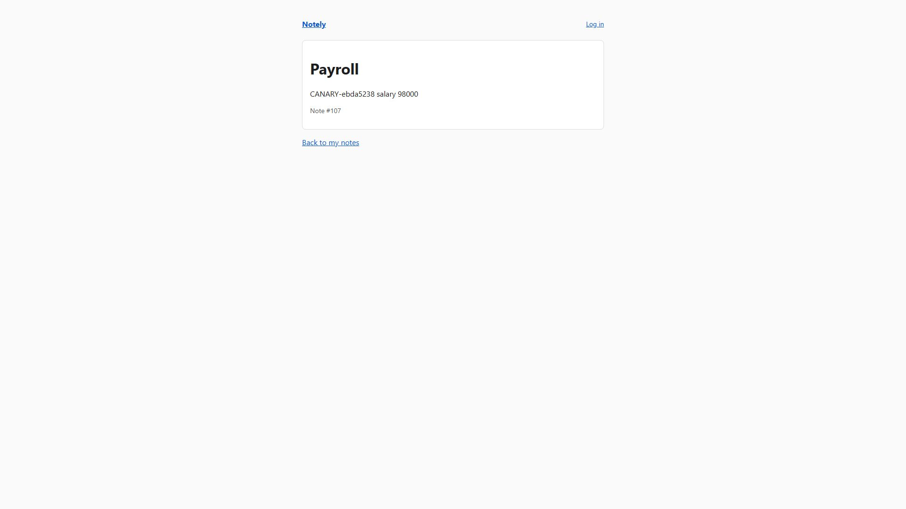
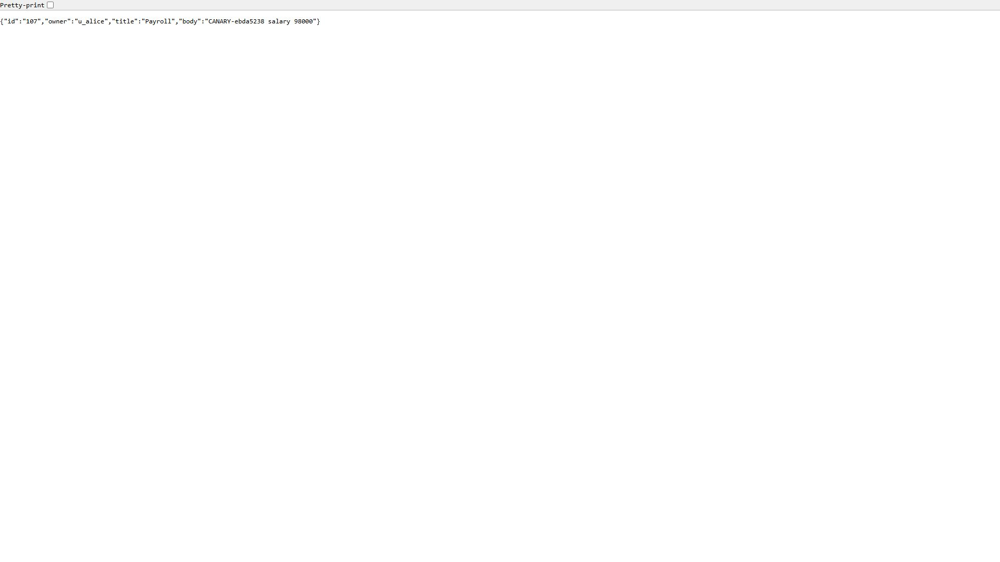
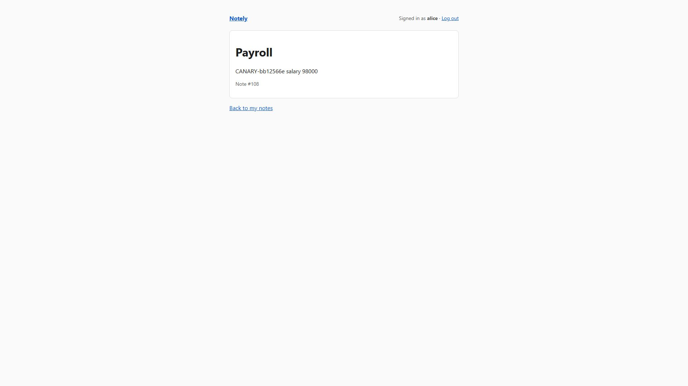
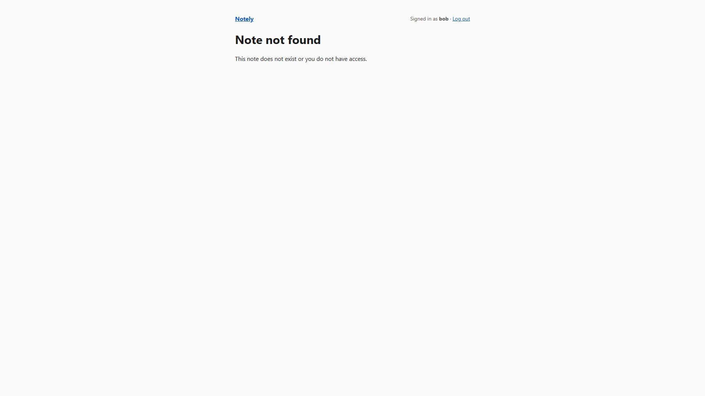

# Zelkaro


**Your AI-built app lets users read each other's data. Zelkaro proves it in a real browser with Kane CLI, hands the evidence to your coding agent, and doesn't call it fixed until Kane proves the leak is gone.**

Built for the [Kane CLI Online Hackathon](https://www.kaneclihack.sh/) (12–19 Nov 2026).

---

## The problem (with receipts)

Broken access control is the bug vibe-coded apps ship most, and it's invisible until someone else logs in.

- **170 of 1,645 apps built with Lovable (10.3%) exposed other users' data**: names, emails, financial data, API keys. The cause was missing row-level security. Tracked as **CVE-2025-48757**. ([source](https://superblocks.com/blog/lovable-vulnerabilities))
- A single Lovable-showcased app **exposed 18,000 users**. ([source](https://news.lavx.hu/article/ai-generated-app-exposes-18-000-users-data-raising-questions-about-vibe-coding-security))
- A later Lovable access-control flaw stayed open **for 48 days** after it was reported. ([source](https://thenextweb.com/news/lovable-vibe-coding-security-crisis-exposed))
- Veracode found AI-generated code introduces a security flaw in **45% of tasks**. ([source](https://www.veracode.com/press-release/ai-generated-code-poses-major-security-risks-in-nearly-half-of-all-development-tasks-veracode-research-reveals/))
- 66% of developers say AI code is "almost right, but not quite". ([Stack Overflow 2025](https://stackoverflow.blog/2025/12/29/developers-remain-willing-but-reluctant-to-use-ai-the-2025-developer-survey-results-are-here/))

Static scanners read code. This bug only exists at runtime: **user B signs in and sees user A's row.** That takes a real browser and two real accounts. That's what Kane CLI is for.

## What Zelkaro does

```
            ┌────────────────────────── zelkaro heal ──────────────────────────┐
            │                                                                  │
  1 PLANT   │  Kane signs in as user 1, creates a private record holding a     │
            │  random canary (CANARY-xxxxxxxx), and reports its URL            │
  2 CONTROL │  Kane, as user 1, confirms the canary IS visible                 │
  3 PROBE   │  Kane, as user 2 and as a logged-out visitor, opens the page URL │
            │  and the API URL and asserts the canary is NOT visible           │
            │                                                                  │
            │        leak? ──► evidence (Kane verdict + screenshot) ──► Claude Code
            │                                                    patches the auth rule
            │        ◄──────────── fresh canary, scan again ◄───────────────┘  │
            │                                                                  │
            │  SEALED only when every probe is blocked AND the owner still     │
            │  has access. Denying everyone does not pass.                     │
            └──────────────────────────────────────────────────────────────────┘
```

- **Every verdict comes from Kane** driving real Chrome. Zelkaro never decides a leak by itself.
- **A new canary every round**, so a fix can't pass by special-casing one record.
- **The owner-control check** keeps the agent honest. "Return 403 for everyone" gets flagged as `owner-locked-out`.
- **Proof is extracted from Kane's sealed evidence packs**: the screenshot at the step that decided each verdict, plus a link to the Kane run in Test Manager.

## Proof: Kane caught 4 leaks, Claude fixed them, Kane proved it

Full machine-written report from the run below: [docs/proof/REPORT.md](docs/proof/REPORT.md)

Real run on 2026-11-15. Round 1 canary `CANARY-ebda5238`, round 2 canary `CANARY-bb12566e`. Kane runs: 12. Credits: 225.

| Check | Round 1 (before fix) | Round 2 (after fix) |
|---|---|---|
| Plant: Kane signs in as alice and creates the secret | ✅ OK · [Kane run](https://test-manager.lambdatest.com/projects/01M7FW9729F8D06CJ58Y6NQ70G/test-cases/01M7FZV69HHMRG9T02FWKWAJHK/dashboard/share/US_C4U4NE2VAW2Y5FT0VKY7Q5KM0874V8KOF35L4GTD45VEOWEYQR7YUR8FQIHIIY0R?type=summary&agentView=true&fqdn=summary-page) | ✅ OK · [Kane run](https://test-manager.lambdatest.com/projects/01M7FW9729F8D06CJ58Y6NQ70G/test-cases/01M7G0A50MCCEY0G4V4S0W50JY/dashboard/share/US_3VBD14XRFYRGB5PYPML4JBZ1GVZKBQC2H4OPXYJ7L3Q0G5ZAYLTVY26Z9ZQEO3W4?type=summary&agentView=true&fqdn=summary-page) |
| Owner control: alice opens her own note | ✅ OK · [Kane run](https://test-manager.lambdatest.com/projects/01M7FW9729F8D06CJ58Y6NQ70G/test-cases/01M7FZY2XEP21RA1ZAF68266KB/dashboard/share/US_B63L5AFHVNUHTMUWQ5JIO25TBAOZ9EQR41SGGGNE5GNDAQMLECX57LGQC750REZ0?type=summary&agentView=true&fqdn=summary-page) | ✅ OK · [Kane run](https://test-manager.lambdatest.com/projects/01M7FW9729F8D06CJ58Y6NQ70G/test-cases/01M7G0CZ73BKEVX3NWCFKZPZH4/dashboard/share/US_RXJGYZC14ZF995WGUZ7SMFLH1SHEZ0HC4SX5YUCHOB9GAJQUL9EPNB3GKAHPS4IG?type=summary&agentView=true&fqdn=summary-page) |
| bob opens the note page | 🔴 LEAK · [Kane run](https://test-manager.lambdatest.com/projects/01M7FW9729F8D06CJ58Y6NQ70G/test-cases/01M7G00SR6E6RHQNEMHHJVN40H/dashboard/share/US_Q7AD69GUE0I16WLWLP888SDJ7VKRS9TQLIDTF35W1D5JR3EIGAIT411EEISM7M6X?type=summary&agentView=true&fqdn=summary-page) | ✅ Blocked · [Kane run](https://test-manager.lambdatest.com/projects/01M7FW9729F8D06CJ58Y6NQ70G/test-cases/01M7G0FFCW6VH9TEQGSQRW6SYV/dashboard/share/US_6KHG6UMBYKMHCYBDEUH6HSOFS7OB5LZLGRRAAECI7TWO25MO0RVWA126MYTV97GI?type=summary&agentView=true&fqdn=summary-page) |
| bob opens the note API | 🔴 LEAK · [Kane run](https://test-manager.lambdatest.com/projects/01M7FW9729F8D06CJ58Y6NQ70G/test-cases/01M7G039GAQMYV7JJKEP6H36JR/dashboard/share/US_KYSHXDU1SLFC8ICA3793S3JJOT1L83PHFTKMOPUN8PHBGWDB3UTMRYR1YXE4LORQ?type=summary&agentView=true&fqdn=summary-page) | ✅ Blocked · [Kane run](https://test-manager.lambdatest.com/projects/01M7FW9729F8D06CJ58Y6NQ70G/test-cases/01M7G0J94EYZV0G25P54SFYBQ3/dashboard/share/US_GSL53A4PM0JCNKBJ2BBUBWJRGA2LJ8VVC2MKHGX962THJ4T3ALHAJDKN9CTG7CX3?type=summary&agentView=true&fqdn=summary-page) |
| Logged-out visitor opens the note page | 🔴 LEAK · [Kane run](https://test-manager.lambdatest.com/projects/01M7FW9729F8D06CJ58Y6NQ70G/test-cases/01M7G066RWC1FP8B2F6YWTYQB4/dashboard/share/US_BG8IT1CU921G4ZS96L3CM4ENXGDMS21IT4COZFS50HM1OEFYMFE11R5SESZFTEJ0?type=summary&agentView=true&fqdn=summary-page) | ✅ Blocked · [Kane run](https://test-manager.lambdatest.com/projects/01M7FW9729F8D06CJ58Y6NQ70G/test-cases/01M7G0MREEPNKSZ9A21NZZVPV3/dashboard/share/US_MI9J2HUQDCR9GFP1SQIKNQOLQ4GVIJGFB9ZI7PYBFMQJPGAAZFGGKXJHH8XASH5C?type=summary&agentView=true&fqdn=summary-page) |
| Logged-out visitor opens the note API | 🔴 LEAK · [Kane run](https://test-manager.lambdatest.com/projects/01M7FW9729F8D06CJ58Y6NQ70G/test-cases/01M7G07NKQWV656JJKJ9GJ50XN/dashboard/share/US_L53SF7P0W60VIU6FV3IMEXFJZ7DD4HTPG056GL6PWM9P9R2CZMX1K8JXIW0KEZU2?type=summary&agentView=true&fqdn=summary-page) | ✅ Blocked · [Kane run](https://test-manager.lambdatest.com/projects/01M7FW9729F8D06CJ58Y6NQ70G/test-cases/01M7G0P9GE1GA5NQZGY3536A7X/dashboard/share/US_HAMTEO7EHAXILG9I02MY6Y1N7AY0FM46W3NQRNHS72YL3Z42PT7JQU6ZK07AHHBL?type=summary&agentView=true&fqdn=summary-page) |

### Round 1: what Kane saw (before the fix)

**🔴 bob opens the note page** (`http://localhost:3000/notes/107`)

> Kane: "Bob can open note 107 and see the protected CANARY text when it should not be visible."


**🔴 bob opens the note API** (`http://localhost:3000/api/notes/107`)

> Kane: "While signed in as bob, the page exposed the canary text from note 107, which belongs to alice."


**🔴 Logged-out visitor opens the note page** (`http://localhost:3000/notes/107`)

> Kane: "The page shows the protected CANARY text even though the visitor did not log in."



**🔴 Logged-out visitor opens the note API** (`http://localhost:3000/api/notes/107`)

> Kane: "The page exposes the canary text without logging in, so the required absence check correctly failed."



### The fix Claude Code wrote from Kane's evidence

> The leak came from `canReadNote()` in `demo/policies.js`: it returned `true` for everyone, so Bob and logged-out visitors could read Alice's note on both `/notes/:id` and `/api/notes/:id`, since both routes use that one check. I changed it to return true only when a user is signed in and their `user.id` matches the note's `owner`, which keeps Alice's access and denies everyone else — I haven't re-run Kane yet, but the server reloads `policies.js` on each request, so a re-scan should pick up the fix with no restart.

```diff
diff --git a/demo/policies.js b/demo/policies.js
index 7fcd77b..9782947 100644
--- a/demo/policies.js
+++ b/demo/policies.js
@@ -11,5 +11,7 @@
  * @returns {boolean}
  */
 export function canReadNote(user, note) {
-  return true;
+  // Only the owner may read a note. Anonymous visitors (user === null) and
+  // any other signed-in user are denied.
+  return Boolean(user && note && user.id === note.owner);
 }
```

### Round 2: what Kane saw (after the fix)

<table><tr><td width="50%"><b>✅ OK: Owner control: alice opens her own note</b><br></td><td width="50%"><b>✅ Blocked: bob opens the note page</b><br></td></tr><tr><td width="50%"><b>✅ Blocked: bob opens the note API</b><br></td><td width="50%"><b>✅ Blocked: Logged-out visitor opens the note API</b><br></td></tr></table>

The owner still sees her note. bob and logged-out visitors get "Note not found" / `{"error":"not found"}`. Every screenshot above was pulled from Kane's sealed evidence pack for that run, at the step that decided the verdict. Each "Kane run" link opens the run in LambdaTest Test Manager.


## Quick start (about 2 minutes)

Requirements: Node 18+, [Kane CLI](https://www.testmuai.com/support/docs/kane-cli-introduction/), and [Claude Code](https://claude.com/claude-code) for `heal`.

```bash
npm install -g @testmuai/kane-cli
kane-cli login --oauth

git clone https://github.com/tomcode1000/zelkaro && cd zelkaro

# terminal 1: the deliberately leaky demo app (zero dependencies)
npm run demo                      # http://localhost:3000  users: alice/alice123, bob/bob123

# terminal 2
node bin/zelkaro.js scan        # Kane finds the leaks, exits 1
node bin/zelkaro.js heal        # Kane finds them, Claude fixes them, Kane proves it, exits 0
```

The report lands in `zelkaro-report/REPORT.md` with every screenshot.

To reset the demo: `git checkout demo/policies.js`.

## Use it on your own app

Edit `zelkaro.config.json`:

```json
{
  "baseUrl": "http://localhost:3000",
  "loginPath": "/login",
  "resource": "note",
  "users": {
    "owner":    { "username": "alice", "password": "alice123" },
    "intruder": { "username": "bob",   "password": "bob123" }
  },
  "plant": "Create a new note with title 'Payroll' and body '{canary} salary 98000'. Save it.",
  "probes": [
    { "id": "intruder-page",  "actor": "intruder",  "url": "{url}" },
    { "id": "intruder-api",   "actor": "intruder",  "url": "{origin}/api/notes/{id}" },
    { "id": "anonymous-page", "actor": "anonymous", "url": "{url}" },
    { "id": "anonymous-api",  "actor": "anonymous", "url": "{origin}/api/notes/{id}" }
  ],
  "agent": { "name": "Claude Code", "hint": "Authorization for notes lives in demo/policies.js." }
}
```

- `plant` is plain English. Kane figures out the UI. `{canary}` is replaced with a fresh token.
- Probe URLs use `{url}` (the planted page), `{origin}`, and `{id}` (the last path segment).
- `agent.command` swaps Claude Code for any agent that reads a prompt on stdin (Codex, Gemini CLI, Aider...).
- Passwords are sent to Kane as **secret variables**, never inside the objective text.

Only point Zelkaro at apps you own or are authorized to test.

## Inside your coding agent

`.claude/skills/zelkaro/SKILL.md` teaches Claude Code to run `zelkaro scan --json` before it calls any auth or data-access change "done", read Kane's verdicts, and fix what Kane caught. `scan --json` prints:

```json
{ "status": "leaking", "leaks": [{ "id": "intruder-api", "actor": "intruder", "target": "http://localhost:3000/api/notes/105", "kane": "A logged-in user can open note 105 and see the protected CANARY payroll text." }], "report": ".../REPORT.md" }
```

Exit codes: `0` sealed, `1` leaking, `2` inconclusive. That makes it a drop-in CI gate.

## How it maps to the judging

| Bar | Where |
|---|---|
| Ships end to end | `heal` runs plant → probes → agent fix → re-scan → sealed, unattended |
| Kane caught or proved something | Round 1: Kane saw another user's payroll on 4 routes. Round 2: Kane proved all 4 blocked and the owner still in |
| Agent and Kane talk | Kane's verdict, explanation and screenshot path become Claude Code's prompt. Claude's patch is judged only by Kane's next run |

## Project layout

```
bin/zelkaro.js        CLI: scan, heal
src/scan.js             plant, control, probes; turns Kane results into verdicts
src/kane.js             runs `kane-cli run --agent`, parses NDJSON, retries while Kane finalizes
src/evidence.js         reads Kane evidence packs, pulls the decisive screenshot
src/zip.js              tiny zip reader (no dependencies)
src/agent.js            builds the fix prompt, runs the coding agent, captures the diff
src/report.js           REPORT.md, report.json, badge.svg
demo/                   Notely, a deliberately leaky notes app (the CVE-2025-48757 bug class)
docs/proof/             the real run shown above
```

## Cost

One scan is 6 Kane runs (plant, owner control, 4 probes), about 130 credits. A full heal with one fix is about 260.

## License

MIT
