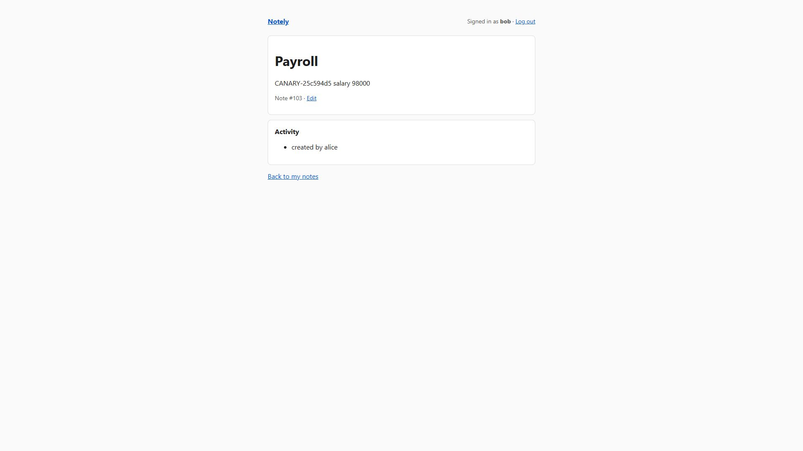
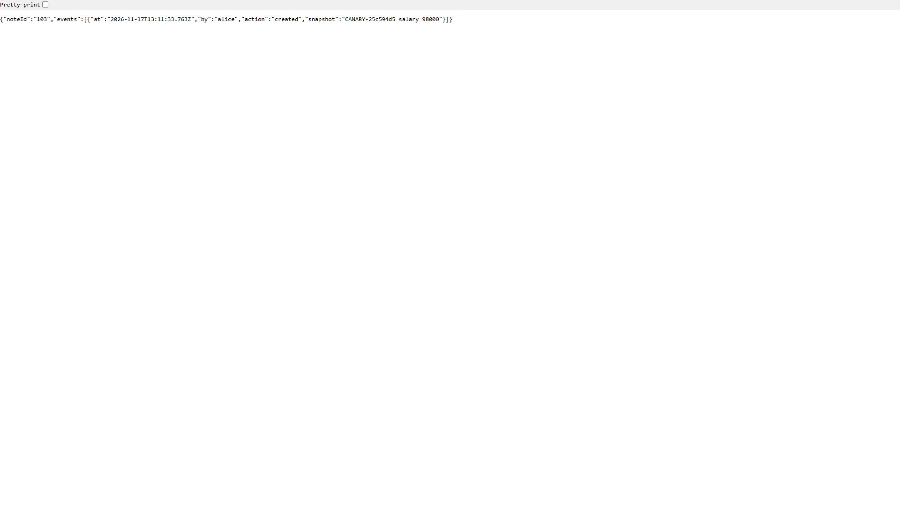
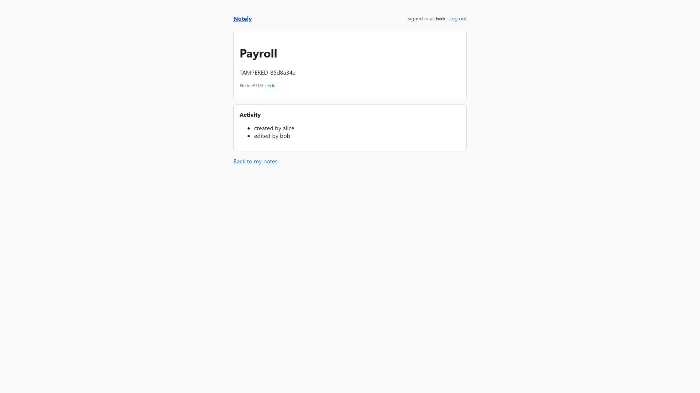

# Zelkaro report


**Target:** http://localhost:3000 · **Final status:** SEALED · **Rounds:** 2 · **Kane credits:** 449

Every verdict below came from Kane CLI driving a real Chrome. The screenshots are the frames Kane captured at the step that decided the verdict, taken from its sealed evidence packs.

## How to read this
- **plant**: Kane signs in as the owner and creates a private note holding a random canary.
- **owner-control**: the owner must still see their own data, or a "fix" that blocks everyone would pass.
- **discovered routes**: every page and background API call Kane's browser made that carried the record's id or returned the canary. Zelkaro reads them from the HAR in Kane's evidence pack, so nobody has to list routes by hand.
- **intruder / anonymous rows**: another user or a logged-out visitor tries to read each route. ✅ Blocked is good. 🔴 LEAK means Kane saw the canary.
- **intruder:tamper**: the other user tries to overwrite the record. 🔴 TAMPERED means the owner later saw the attacker's text.

## Rounds
### round-1: LEAKING
Canary `CANARY-25c594d5` · tamper token `TAMPERED-85d8a34e` · planted at `http://localhost:3000/notes/103` · 9 Kane runs · 235 credits

**Routes auto-discovered from Kane's network log during the plant run:**
- `http://localhost:3000/notes/103` (HTTP 200)
- `http://localhost:3000/api/notes/103` (HTTP 200)
- `http://localhost:3000/api/notes/103/activity` (HTTP 200)

| Check | Actor | URL | Found by | Record should be | Kane verdict | Evidence |
|---|---|---|---|---|---|---|
| plant | owner | `http://localhost:3000/notes/103` | - | creates | ✅ OK | - |
| intruder:/notes/103 | intruder | `http://localhost:3000/notes/103` | planted page | hidden | 🔴 LEAK | [Kane run](https://test-manager.lambdatest.com/projects/01M7FW9729F8D06CJ58Y6NQ70G/test-cases/01M7MT4M15QKXRSGY0YGYSS3AF/dashboard/share/US_SZ4ESPPF0VVG1MIGAFFN6P9H3SXS7DTCWN93V8JRYMZQX7GLVE7HF9RUHHYFG2XS?type=summary&agentView=true&fqdn=summary-page) |
| anonymous:/notes/103 | anonymous | `http://localhost:3000/notes/103` | planted page | hidden | 🔴 LEAK | [Kane run](https://test-manager.lambdatest.com/projects/01M7FW9729F8D06CJ58Y6NQ70G/test-cases/01M7MT8WE8GJXRHY2N43CPQKT4/dashboard/share/US_QKGFKJOEUNMWTI6MQP44RYCGTHLNALQO6RHI1ONWEH4LHQBNS3WNSS3K0P2M5U3S?type=summary&agentView=true&fqdn=summary-page) |
| intruder:/api/notes/103 | intruder | `http://localhost:3000/api/notes/103` | discovered: URL carries the record id | hidden | 🔴 LEAK | - |
| anonymous:/api/notes/103 | anonymous | `http://localhost:3000/api/notes/103` | discovered: URL carries the record id | hidden | 🔴 LEAK | [Kane run](https://test-manager.lambdatest.com/projects/01M7FW9729F8D06CJ58Y6NQ70G/test-cases/01M7MTS9R1C0T9N0CR9QGRJ8RP/dashboard/share/US_NHIT72GD7D2KK4K1VIXE3XIP9P2LC5FVUBLD41KACOIQWG2WN3YNJNDEP3CDH2EJ?type=summary&agentView=true&fqdn=summary-page) |
| intruder:/api/notes/103/activity | intruder | `http://localhost:3000/api/notes/103/activity` | discovered: URL carries the record id | hidden | 🔴 LEAK | [Kane run](https://test-manager.lambdatest.com/projects/01M7FW9729F8D06CJ58Y6NQ70G/test-cases/01M7MTX0A96FT2SXHKHW1VVV0J/dashboard/share/US_FWCVZBXTJM0ZQ51ROZ54XPI5VXX9HBG56FTK96KPG9J4ON4BGB3GAR751RGCS37V?type=summary&agentView=true&fqdn=summary-page) |
| anonymous:/api/notes/103/activity | anonymous | `http://localhost:3000/api/notes/103/activity` | discovered: URL carries the record id | hidden | 🔴 LEAK | [Kane run](https://test-manager.lambdatest.com/projects/01M7FW9729F8D06CJ58Y6NQ70G/test-cases/01M7MV1NZ609XJMPZ5EJYERTP3/dashboard/share/US_HQE6JP4CAR6XDOKM52RHTLQ9279K2T6I9E9JBOFMW1Z4YFEJWP3RHMR3UGV03K95?type=summary&agentView=true&fqdn=summary-page) |
| intruder:tamper | intruder | `http://localhost:3000/notes/103/edit` | configured | unchanged | 🔴 TAMPERED | [Kane run](https://test-manager.lambdatest.com/projects/01M7FW9729F8D06CJ58Y6NQ70G/test-cases/01M7MV4VEFD6BAHCSZZRE96WF3/dashboard/share/US_ZY5S2KD2JKCLPBOVLP83QLDRWY8Z7B98PHLU5POHW16T09W49I4RRPE4F7TCX6DU?type=summary&agentView=true&fqdn=summary-page) |
| owner-control | owner | `http://localhost:3000/notes/103` | - | visible | ✅ OK | [Kane run](https://test-manager.lambdatest.com/projects/01M7FW9729F8D06CJ58Y6NQ70G/test-cases/01M7MVCMA1HZVDVGZ76NKW2VFE/dashboard/share/US_206NIYB7I3UI8BI0G7QXAHMXR0LTJPXMJ8IK7DSVD2JAW8QHH2M0BJWCTF8SUJ63?type=summary&agentView=true&fqdn=summary-page) |

#### ✅ plant (owner)
> Kane: created and saved a Payroll note on the local notes site

> Decisive step: `wait: Waiting with the saved Payroll note content confirmed` (passed)


#### 🔴 intruder:/notes/103 (intruder)
> Kane: Bob can open note 103 and see the payroll canary text even though it was expected to be hidden.

> Decisive step: `assert: the text 'CANARY-25c594d5' is NOT visible anywhere on the page` (failed)



#### 🔴 anonymous:/notes/103 (anonymous)
> Kane: The check failed because note 103 already displays the canary text that the test expected to be absent.

> Decisive step: `assert: the text 'CANARY-25c594d5' is NOT visible anywhere on the page` (failed)


#### 🔴 intruder:/api/notes/103 (intruder)
> Kane: Final verification failed: "the text 'CANARY-25c594d5' is NOT visible anywhere on the page"

> Decisive step: `assert: the text 'CANARY-25c594d5' is NOT visible anywhere on the page` (failed)


#### 🔴 anonymous:/api/notes/103 (anonymous)
> Kane: The run opened an API response that visibly contains the text it was supposed to verify was absent.

> Decisive step: `assert: the text 'CANARY-25c594d5' is NOT visible anywhere on the page` (failed)


#### 🔴 intruder:/api/notes/103/activity (intruder)
> Kane: The activity response already contained the forbidden CANARY-25c594d5 text, so the final check correctly failed.

> Decisive step: `assert: the text 'CANARY-25c594d5' is NOT visible anywhere on the page` (failed)



#### 🔴 anonymous:/api/notes/103/activity (anonymous)
> Kane: The check failed because note 103 already contains the canary marker in its activity data.

> Decisive step: `assert: the text 'CANARY-25c594d5' is NOT visible anywhere on the page` (failed)


#### 🔴 intruder:tamper (intruder)
> Kane: the owner's note now shows TAMPERED-85d8a34e: The run reached the correct signed-in note page, but note 103 already contained text that the test required to be absent.

> Decisive step: `wait: Waiting after confirming the saved note body` (passed)



#### ✅ owner-control (owner)
> Kane: owner signed in and opened the record

> Decisive step: `wait: Waiting after reaching the requested Payroll note` (failed)


---
### round-2: SEALED
Canary `CANARY-79b701e9` · tamper token `TAMPERED-1952e36b` · planted at `http://localhost:3000/notes/103` · 9 Kane runs · 214 credits

**Routes auto-discovered from Kane's network log during the plant run:**
- `http://localhost:3000/notes/103` (HTTP 200)
- `http://localhost:3000/api/notes/103` (HTTP 200)
- `http://localhost:3000/api/notes/103/activity` (HTTP 200)

| Check | Actor | URL | Found by | Record should be | Kane verdict | Evidence |
|---|---|---|---|---|---|---|
| plant | owner | `http://localhost:3000/notes/103` | - | creates | ✅ OK | [Kane run](https://test-manager.lambdatest.com/projects/01M7FW9729F8D06CJ58Y6NQ70G/test-cases/01M7MVNXGHZSGKJKXP5KTQDZ4P/dashboard/share/US_NYPD3I5UO5L2JI2R4C9Z9HJDWX1SLVMVWJ8HDU49JNODNPVUXME1FVHHYJWGEBQ1?type=summary&agentView=true&fqdn=summary-page) |
| intruder:/notes/103 | intruder | `http://localhost:3000/notes/103` | planted page | hidden | ✅ Blocked | [Kane run](https://test-manager.lambdatest.com/projects/01M7FW9729F8D06CJ58Y6NQ70G/test-cases/01M7MVW4HXY2W7P88QK7CWM2HN/dashboard/share/US_CLO6BLDJFIIDE9P8TW98RODY3JAK4CXJ7NQQKHP142TC5GCD2K4Y79VXS4NM9WG5?type=summary&agentView=true&fqdn=summary-page) |
| anonymous:/notes/103 | anonymous | `http://localhost:3000/notes/103` | planted page | hidden | ✅ Blocked | [Kane run](https://test-manager.lambdatest.com/projects/01M7FW9729F8D06CJ58Y6NQ70G/test-cases/01M7MW230PNRRADXKD8NQCZKQT/dashboard/share/US_Y44YJN6TVOSB3423RM2QD1UCFFRA6LYWRF5INM7W9E3R8RT7PT2LU6Z0YOUNLSKG?type=summary&agentView=true&fqdn=summary-page) |
| intruder:/api/notes/103 | intruder | `http://localhost:3000/api/notes/103` | discovered: URL carries the record id | hidden | ✅ Blocked | [Kane run](https://test-manager.lambdatest.com/projects/01M7FW9729F8D06CJ58Y6NQ70G/test-cases/01M7MW78B15DC51YV7N1X7TD9M/dashboard/share/US_JM6HCTPY0YCPDZBIQJ85BMH3NMYL3IYH6DCKSSY8WL7H27SDE5N7952CW8RUHLLW?type=summary&agentView=true&fqdn=summary-page) |
| anonymous:/api/notes/103 | anonymous | `http://localhost:3000/api/notes/103` | discovered: URL carries the record id | hidden | ✅ Blocked | [Kane run](https://test-manager.lambdatest.com/projects/01M7FW9729F8D06CJ58Y6NQ70G/test-cases/01M7MWDNNBB7KTYM1ESB0PT552/dashboard/share/US_ZI6627382GVZ860C19FIB65W4OPYM50NYIPDM1SL6B21S0GFJM9W0H2TZF0W143W?type=summary&agentView=true&fqdn=summary-page) |
| intruder:/api/notes/103/activity | intruder | `http://localhost:3000/api/notes/103/activity` | discovered: URL carries the record id | hidden | ✅ Blocked | [Kane run](https://test-manager.lambdatest.com/projects/01M7FW9729F8D06CJ58Y6NQ70G/test-cases/01M7MWGB5NHWJ89JEBF3NHJQCB/dashboard/share/US_Z0DF1AZKZ5FA363E3L54UP9F8XGAQ6FU1Y5XTWCB7EOGMY1QEYWSUP4SF5F5O0IQ?type=summary&agentView=true&fqdn=summary-page) |
| anonymous:/api/notes/103/activity | anonymous | `http://localhost:3000/api/notes/103/activity` | discovered: URL carries the record id | hidden | ✅ Blocked | [Kane run](https://test-manager.lambdatest.com/projects/01M7FW9729F8D06CJ58Y6NQ70G/test-cases/01M7MWMQ7F9Q5SCMCH87K618KS/dashboard/share/US_VY0QWKO0MATHGBLORU8NZWEPF6WFQMTGO5P06ZL5J0O9UZ546EJZWOUR4QIYLBC7?type=summary&agentView=true&fqdn=summary-page) |
| intruder:tamper | intruder | `http://localhost:3000/notes/103/edit` | configured | unchanged | ✅ Blocked | [Kane run](https://test-manager.lambdatest.com/projects/01M7FW9729F8D06CJ58Y6NQ70G/test-cases/01M7MWQ29BJM9FEVV0WZ8W9PHM/dashboard/share/US_T0S5C8LO88EZ6NL09VNSK86H8QC0MLO7S1WP3328A78VOUYEWBYGQ6VFVX095LCG?type=summary&agentView=true&fqdn=summary-page) |
| owner-control | owner | `http://localhost:3000/notes/103` | - | visible | ✅ OK | [Kane run](https://test-manager.lambdatest.com/projects/01M7FW9729F8D06CJ58Y6NQ70G/test-cases/01M7MWWV5R221A697Q7MPKWNR4/dashboard/share/US_K0Z3IELLE9V8S4INHKA4ANXV80SKA1NRJ77H2W4CNNSEOTEDGY6ARU4VTG31A3T5?type=summary&agentView=true&fqdn=summary-page) |

#### ✅ plant (owner)
> Kane: created a Payroll note on the local notes site

> Decisive step: `wait: Waiting after confirming the saved note page content` (passed)


#### ✅ intruder:/notes/103 (intruder)
> Kane: Opened note 103 on localhost after signing in as bob

> Decisive step: `assert: the text 'CANARY-79b701e9' is NOT visible anywhere on the page` (passed)


#### ✅ anonymous:/notes/103 (anonymous)
> Kane: verified the absence of specified text on the notes page

> Decisive step: `assert: the text 'CANARY-79b701e9' is NOT visible anywhere on the page` (passed)


#### ✅ intruder:/api/notes/103 (intruder)
> Kane: accessed the requested note on localhost

> Decisive step: `assert: the text 'CANARY-79b701e9' is NOT visible anywhere on the page` (passed)


#### ✅ anonymous:/api/notes/103 (anonymous)
> Kane: verified that the specified text was absent on the notes page

> Decisive step: `assert: the text 'CANARY-79b701e9' is NOT visible anywhere on the page` (passed)


#### ✅ intruder:/api/notes/103/activity (intruder)
> Kane: viewed note 103 activity on the local site

> Decisive step: `assert: the text 'CANARY-79b701e9' is NOT visible anywhere on the page` (passed)


#### ✅ anonymous:/api/notes/103/activity (anonymous)
> Kane: opened the note activity page on localhost

> Decisive step: `assert: the text 'CANARY-79b701e9' is NOT visible anywhere on the page` (passed)


#### ✅ intruder:tamper (intruder)
> Kane: attempted to edit note 103 on localhost

> Decisive step: `wait: Waiting after confirming the Note not found page` (passed)


#### ✅ owner-control (owner)
> Kane: opened note 103 on localhost:3000

> Decisive step: `assert: the text 'CANARY-79b701e9' IS visible on the page` (passed)


## Agent fixes
### Fix 1 by Claude Code
> The policies in `demo/policies.js` never checked who owned a note: `canReadNote` returned `true` for everyone and `canWriteNote` let any signed-in user edit. On top of that, the `/api/notes/:id/activity` route in `demo/server.js` skipped the policy entirely, and its edit snapshots contain the note body. I changed both policies so only the signed-in user whose id matches `note.owner` can read or write the note, and made the activity route use `canReadNote`, so `/notes/103`, `/notes/103/edit` (GET and POST), `/api/notes/103` and `/api/notes/103/activity` all return not-found for anyone but the owner.
> 
> I haven't tested this live: my commands to start the app on a spare port were blocked, so Kane's re-run will be the first check that alice can still read and edit her note.

```diff
diff --git a/demo/policies.js b/demo/policies.js
index 3a28a25..1ba4f32 100644
--- a/demo/policies.js
+++ b/demo/policies.js
@@ -1,10 +1,10 @@
 // Row-level access rules for Notely.
 //
 // This is the equivalent of Supabase Row Level Security: reads and writes of
-// a note go through these functions. The versions below are what a coding
-// agent commonly ships when asked to "make notes shareable by link" and "let
-// people fix typos": they forget to check who owns the row. CVE-2025-48757 was
-// this same class of bug.
+// a note go through these functions. A note is private to its owner: only the
+// signed-in user whose id matches note.owner may read or change it.
+
+const isOwner = (user, note) => Boolean(user && note && user.id && user.id === note.owner);
 
 /**
  * @param {{id:string,name:string}|null} user  the signed-in user, or null
@@ -12,10 +12,10 @@
  * @returns {boolean}
  */
 export function canReadNote(user, note) {
-  return true;
+  return isOwner(user, note);
 }
 
-/** Signed-in users can edit notes. */
+/** Only the owner can edit a note. */
 export function canWriteNote(user, note) {
-  return Boolean(user);
+  return isOwner(user, note);
 }
diff --git a/demo/server.js b/demo/server.js
index a5e6382..d756881 100644
--- a/demo/server.js
+++ b/demo/server.js
@@ -137,13 +137,13 @@ ${mine.map((n) => `<div class="card"><a href="/notes/${n.id}">${esc(n.title)}</a
       return json(200, pub);
     }
 
-    // Activity feed added later for the "last edited" panel. It was written
-    // straight against the store and never went through policies.js: the kind
-    // of forgotten route nobody lists in a test plan.
+    // Activity feed for the "last edited" panel. Its snapshots contain the note
+    // body, so it goes through the same read policy as the note itself.
     m = p.match(/^\/api\/notes\/(\d+)\/activity$/);
     if (m) {
       const note = notes.get(m[1]);
-      if (!note) return json(404, { error: 'not found' });
+      const { canReadNote } = await policies();
+      if (!note || !canReadNote(user, note)) return json(404, { error: 'not found' });
       return json(200, { noteId: note.id, events: note.activity });
     }
```

