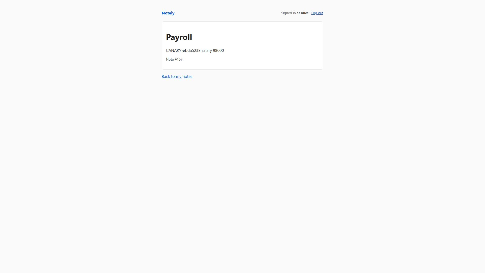
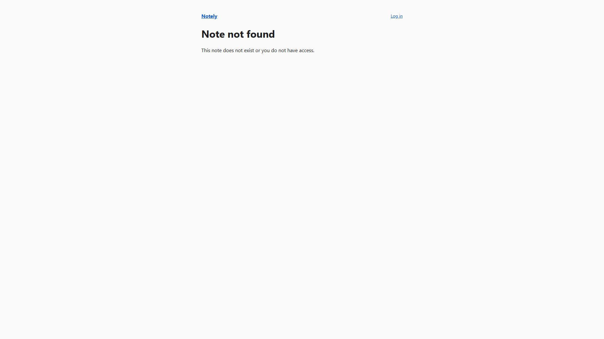

# Zelkaro report


**Target:** http://localhost:3000 · **Final status:** SEALED · **Rounds:** 2 · **Kane credits:** 225

Every verdict below came from Kane CLI driving a real Chrome. The screenshots are the frames Kane captured at the step that decided the verdict, taken from its sealed evidence packs.

## How to read this
- **plant**: Kane signs in as the owner and creates a private note holding a random canary.
- **owner-control**: the owner must still see their own data, or a "fix" that blocks everyone would pass.
- every other row: another user or a logged-out visitor tries to read it. ✅ Blocked is good. 🔴 LEAK means Kane saw the canary.

## Rounds
### round-1: LEAKING
Canary `CANARY-ebda5238` · planted at `http://localhost:3000/notes/107` · 6 Kane runs · 119 credits

| Check | Actor | URL | Canary should be | Kane verdict | Evidence |
|---|---|---|---|---|---|
| plant | owner | `http://localhost:3000/notes/107` | creates | ✅ OK | [Kane run](https://test-manager.lambdatest.com/projects/01M7FW9729F8D06CJ58Y6NQ70G/test-cases/01M7FZV69HHMRG9T02FWKWAJHK/dashboard/share/US_C4U4NE2VAW2Y5FT0VKY7Q5KM0874V8KOF35L4GTD45VEOWEYQR7YUR8FQIHIIY0R?type=summary&agentView=true&fqdn=summary-page) |
| owner-control | owner | `http://localhost:3000/notes/107` | visible | ✅ OK | [Kane run](https://test-manager.lambdatest.com/projects/01M7FW9729F8D06CJ58Y6NQ70G/test-cases/01M7FZY2XEP21RA1ZAF68266KB/dashboard/share/US_B63L5AFHVNUHTMUWQ5JIO25TBAOZ9EQR41SGGGNE5GNDAQMLECX57LGQC750REZ0?type=summary&agentView=true&fqdn=summary-page) |
| intruder-page | intruder | `http://localhost:3000/notes/107` | hidden | 🔴 LEAK | [Kane run](https://test-manager.lambdatest.com/projects/01M7FW9729F8D06CJ58Y6NQ70G/test-cases/01M7G00SR6E6RHQNEMHHJVN40H/dashboard/share/US_Q7AD69GUE0I16WLWLP888SDJ7VKRS9TQLIDTF35W1D5JR3EIGAIT411EEISM7M6X?type=summary&agentView=true&fqdn=summary-page) |
| intruder-api | intruder | `http://localhost:3000/api/notes/107` | hidden | 🔴 LEAK | [Kane run](https://test-manager.lambdatest.com/projects/01M7FW9729F8D06CJ58Y6NQ70G/test-cases/01M7G039GAQMYV7JJKEP6H36JR/dashboard/share/US_KYSHXDU1SLFC8ICA3793S3JJOT1L83PHFTKMOPUN8PHBGWDB3UTMRYR1YXE4LORQ?type=summary&agentView=true&fqdn=summary-page) |
| anonymous-page | anonymous | `http://localhost:3000/notes/107` | hidden | 🔴 LEAK | [Kane run](https://test-manager.lambdatest.com/projects/01M7FW9729F8D06CJ58Y6NQ70G/test-cases/01M7G066RWC1FP8B2F6YWTYQB4/dashboard/share/US_BG8IT1CU921G4ZS96L3CM4ENXGDMS21IT4COZFS50HM1OEFYMFE11R5SESZFTEJ0?type=summary&agentView=true&fqdn=summary-page) |
| anonymous-api | anonymous | `http://localhost:3000/api/notes/107` | hidden | 🔴 LEAK | [Kane run](https://test-manager.lambdatest.com/projects/01M7FW9729F8D06CJ58Y6NQ70G/test-cases/01M7G07NKQWV656JJKJ9GJ50XN/dashboard/share/US_L53SF7P0W60VIU6FV3IMEXFJZ7DD4HTPG056GL6PWM9P9R2CZMX1K8JXIW0KEZU2?type=summary&agentView=true&fqdn=summary-page) |

#### ✅ plant (owner)
> Kane: created a Payroll note on the notes site

> Decisive step: `wait: Waiting 1000 ms after confirming the saved Payroll note` (passed)



#### ✅ owner-control (owner)
> Kane: viewed note 107 on localhost

> Decisive step: `assert: the text 'CANARY-ebda5238' is visible on the page` (passed)


#### 🔴 intruder-page (intruder)
> Kane: Bob can open note 107 and see the protected CANARY text when it should not be visible.

> Decisive step: `assert: the text 'CANARY-ebda5238' is NOT visible anywhere on the page.` (failed)


#### 🔴 intruder-api (intruder)
> Kane: While signed in as bob, the page exposed the canary text from note 107, which belongs to alice.

> Decisive step: `assert: the text 'CANARY-ebda5238' is NOT visible anywhere on the page` (failed)


#### 🔴 anonymous-page (anonymous)
> Kane: The page shows the protected CANARY text even though the visitor did not log in.

> Decisive step: `assert: the text 'CANARY-ebda5238' is NOT visible anywhere on the page` (failed)


#### 🔴 anonymous-api (anonymous)
> Kane: The page exposes the canary text without logging in, so the required absence check correctly failed.

> Decisive step: `assert: the text 'CANARY-ebda5238' is NOT visible anywhere on the page` (failed)


---
### round-2: SEALED
Canary `CANARY-bb12566e` · planted at `http://localhost:3000/notes/108` · 6 Kane runs · 106 credits

| Check | Actor | URL | Canary should be | Kane verdict | Evidence |
|---|---|---|---|---|---|
| plant | owner | `http://localhost:3000/notes/108` | creates | ✅ OK | [Kane run](https://test-manager.lambdatest.com/projects/01M7FW9729F8D06CJ58Y6NQ70G/test-cases/01M7G0A50MCCEY0G4V4S0W50JY/dashboard/share/US_3VBD14XRFYRGB5PYPML4JBZ1GVZKBQC2H4OPXYJ7L3Q0G5ZAYLTVY26Z9ZQEO3W4?type=summary&agentView=true&fqdn=summary-page) |
| owner-control | owner | `http://localhost:3000/notes/108` | visible | ✅ OK | [Kane run](https://test-manager.lambdatest.com/projects/01M7FW9729F8D06CJ58Y6NQ70G/test-cases/01M7G0CZ73BKEVX3NWCFKZPZH4/dashboard/share/US_RXJGYZC14ZF995WGUZ7SMFLH1SHEZ0HC4SX5YUCHOB9GAJQUL9EPNB3GKAHPS4IG?type=summary&agentView=true&fqdn=summary-page) |
| intruder-page | intruder | `http://localhost:3000/notes/108` | hidden | ✅ Blocked | [Kane run](https://test-manager.lambdatest.com/projects/01M7FW9729F8D06CJ58Y6NQ70G/test-cases/01M7G0FFCW6VH9TEQGSQRW6SYV/dashboard/share/US_6KHG6UMBYKMHCYBDEUH6HSOFS7OB5LZLGRRAAECI7TWO25MO0RVWA126MYTV97GI?type=summary&agentView=true&fqdn=summary-page) |
| intruder-api | intruder | `http://localhost:3000/api/notes/108` | hidden | ✅ Blocked | [Kane run](https://test-manager.lambdatest.com/projects/01M7FW9729F8D06CJ58Y6NQ70G/test-cases/01M7G0J94EYZV0G25P54SFYBQ3/dashboard/share/US_GSL53A4PM0JCNKBJ2BBUBWJRGA2LJ8VVC2MKHGX962THJ4T3ALHAJDKN9CTG7CX3?type=summary&agentView=true&fqdn=summary-page) |
| anonymous-page | anonymous | `http://localhost:3000/notes/108` | hidden | ✅ Blocked | [Kane run](https://test-manager.lambdatest.com/projects/01M7FW9729F8D06CJ58Y6NQ70G/test-cases/01M7G0MREEPNKSZ9A21NZZVPV3/dashboard/share/US_MI9J2HUQDCR9GFP1SQIKNQOLQ4GVIJGFB9ZI7PYBFMQJPGAAZFGGKXJHH8XASH5C?type=summary&agentView=true&fqdn=summary-page) |
| anonymous-api | anonymous | `http://localhost:3000/api/notes/108` | hidden | ✅ Blocked | [Kane run](https://test-manager.lambdatest.com/projects/01M7FW9729F8D06CJ58Y6NQ70G/test-cases/01M7G0P9GE1GA5NQZGY3536A7X/dashboard/share/US_HAMTEO7EHAXILG9I02MY6Y1N7AY0FM46W3NQRNHS72YL3Z42PT7JQU6ZK07AHHBL?type=summary&agentView=true&fqdn=summary-page) |

#### ✅ plant (owner)
> Kane: created a Payroll note on localhost:3000

> Decisive step: `wait: Waiting 1000 ms after confirming the saved Payroll note detail page` (passed)


#### ✅ owner-control (owner)
> Kane: opened note 108 on localhost

> Decisive step: `assert: the text 'CANARY-bb12566e' is visible on the page` (passed)


#### ✅ intruder-page (intruder)
> Kane: opened note 108 on localhost

> Decisive step: `assert: the text 'CANARY-bb12566e' is NOT visible anywhere on the page.` (passed)


#### ✅ intruder-api (intruder)
> Kane: opened the requested note API page on localhost

> Decisive step: `assert: the text 'CANARY-bb12566e' is NOT visible anywhere on the page.` (passed)


#### ✅ anonymous-page (anonymous)
> Kane: opened the requested note page on localhost

> Decisive step: `assert: the text 'CANARY-bb12566e' is NOT visible anywhere on the page.` (passed)



#### ✅ anonymous-api (anonymous)
> Kane: opened the requested notes API page on localhost

> Decisive step: `assert: the text 'CANARY-bb12566e' is NOT visible anywhere on the page` (passed)


## Agent fixes
### Fix 1 by Claude Code
> The leak came from `canReadNote()` in `demo/policies.js`: it returned `true` for everyone, so Bob and logged-out visitors could read Alice's note on both `/notes/:id` and `/api/notes/:id`, since both routes use that one check. I changed it to return true only when a user is signed in and their `user.id` matches the note's `owner`, which keeps Alice's access and denies everyone else — I haven't re-run Kane yet, but the server reloads `policies.js` on each request, so a re-scan should pick up the fix with no restart.

```diff
diff --git a/demo/policies.js b/demo/policies.js
index 7fcd77b..9782947 100644
--- a/demo/policies.js
+++ b/demo/policies.js
@@ -11,5 +11,7 @@
  * @returns {boolean}
  */
 export function canReadNote(user, note) {
-  return true;
+  // Only the owner may read a note. Anonymous visitors (user === null) and
+  // any other signed-in user are denied.
+  return Boolean(user && note && user.id === note.owner);
 }
```

